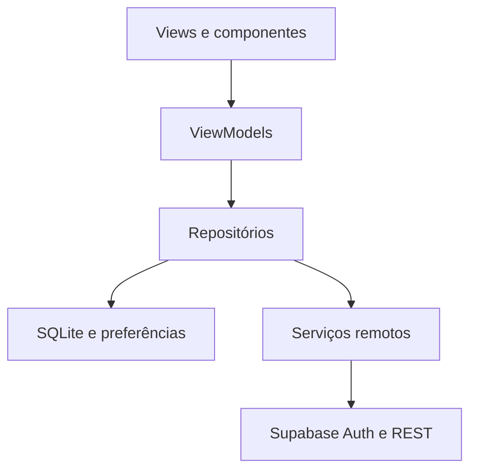

# Simples QR

Aplicativo móvel do Projeto Integrador **Simples QR — Cardápio digital por QR code**.

## Escopo

Voltado a pequenos restaurantes e seus clientes. O cliente acessará um cardápio público identificado por QR code, consultará categorias, preços, ingredientes e disponibilidade e poderá salvar favoritos e consultar cardápios previamente carregados sem internet. Não será necessário criar conta apenas para ler o cardápio.

O proprietário terá autenticação real e uma área protegida para configurar seu restaurante e cadastrar, editar e excluir categorias e produtos. Pedidos, pagamentos, delivery e gestão de funcionários ficam fora do escopo para manter uma solução individual coerente e realizável.

## Integrante e responsabilidades

| Nome | GitHub | Papéis |
|---|---|---|
| Miguel Wainstein | @MiguelWainst | Tech Lead/Arquitetura, UI/UX, Dados, Backend, QA e Governança |

Equipe individual, conforme informado pelo autor. A exigência C6.5 de revisão por outro integrante deverá ter sua forma equivalente alinhada com o professor; não será simulada uma revisão entre pessoas.

## Estado da Sprint 0

Implementados: estrutura MVVM, Design System inicial, temas Claro/Escuro/Sistema com preferência persistida, tela inicial sem dados fictícios e tela de aparência, rotas centralizadas, testes e workflow de CI.

Planejados para as próximas sprints: autenticação, catálogo real, leitura QR, persistência SQLite e integrações. A tela inicial informa explicitamente que o catálogo ainda não está conectado. **Apenas duas telas estão implementadas.** O mínimo de dez telas é um compromisso da entrega final.

Backend escolhido: **Supabase**, para autenticação, PostgreSQL, API REST e políticas RLS. Isso reduz manutenção para um desenvolvedor. O projeto remoto ainda precisa ser provisionado; escolher Supabase e escrever SQL não equivale a ter um backend acessível. A criação remota é uma pendência da Sprint 0 exigida pelo PDF.

## Arquitetura e tecnologia

Flutter 3.47.6 / Dart 3.13.5. MVVM com ChangeNotifier e injeção por construtor. Dependência atual: shared_preferences. Pacotes planejados: supabase_flutter, sqflite, flutter_secure_storage, http e mobile_scanner.



`lib/core`: tema e navegação. `lib/data`: acesso a dados. `lib/features`: telas e ViewModels por funcionalidade. `lib/shared/widgets`: componentes reutilizáveis.

Estratégia offline planejada: SQLite com schema versionado e repositório central; leitura do último catálogo sincronizado; favoritos com CRUD local; exibição da data de atualização. Sem conexão, edição administrativa remota será bloqueada com mensagem clara. Tokens ficam em armazenamento seguro, nunca em preferências simples.

## Mapa preliminar de telas

1. Início / abrir cardápio
2. Leitor de QR code
3. Cardápio com busca e filtro de categorias
4. Detalhes do produto
5. Favoritos
6. Login do proprietário
7. Cadastro do proprietário
8. Recuperação de senha
9. Perfil do proprietário
10. Dados do restaurante
11. Gerenciar categorias
12. Formulário de categoria
13. Gerenciar produtos
14. Formulário de produto
15. QR code do restaurante
16. Aparência (implementada)

## Segurança

Leitura pública apenas de restaurantes publicados e itens disponíveis; edição apenas pelo dono do restaurante com RLS no backend. Sem seleção de perfis privilegiados pelo cliente. Guardas de navegação serão implementadas junto da autenticação. Nenhum login de fachada foi criado.

`supabase/migrations/001_initial.sql` contém tabelas e políticas iniciais para revisão e execução no SQL Editor. Nunca usar service_role no app nem versionar senhas. A configuração futura usará `--dart-define` para URL e chave pública, com sessão armazenada com segurança. Não há credenciais de teste enquanto o backend não estiver criado.

## Como rodar

Com Flutter stable instalado e Android SDK ou Chrome disponíveis:

```sh
flutter pub get
flutter run -d chrome
```

Para Android, abra um emulador ou conecte um aparelho e execute `flutter run`. Se os diretórios de plataforma ainda não existirem, execute `flutter create --platforms=android,web --org br.com.simplesqr --project-name simples_qr .` antes.

```sh
dart format lib test
flutter analyze
flutter test
flutter build web
```

Validação executada no computador do autor em 19/10/2026: `flutter analyze` sem problemas, `flutter test` com 2 testes aprovados e `flutter build web` concluído. Evidência: saída do terminal fornecida pelo autor. Execução visual e build Android ainda não verificados. Consulte `docs/VALIDACAO.md`.

## Planejamento e publicação

`docs/issues.json` é a fonte do backlog. As 45 issues foram criadas, categorizadas por C1–C6, atribuídas a @MiguelWainst e associadas aos marcos das Sprints 0 a 3. O script de publicação apresentou incompatibilidades com Windows PowerShell 5; não é necessário executá-lo novamente para usar o app.

Repositório: https://github.com/MiguelWainst/simples-qr-mobile

Quadro: https://github.com/users/MiguelWainst/projects/1

Issues: https://github.com/MiguelWainst/simples-qr-mobile/issues

APK, vídeo, capturas e protótipo serão adicionados quando existirem.

Governança: [PROMPT_LOG.md](PROMPT_LOG.md). Matriz de requisitos: [docs/REQUISITOS.md](docs/REQUISITOS.md).
